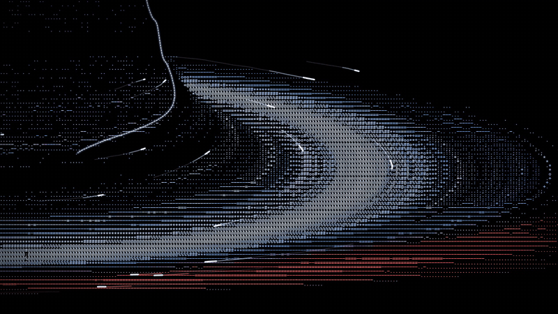

# Ring Trails: an animated ASCII theme for T3 Code



An animated background theme for [T3 Code](https://t3.codes), built from
[**Dogan Ural**'s star-trail vortex](https://x.com/doganuraldesign/status/2099010606720229726)
([@doganuraldesign](https://x.com/doganuraldesign)).

The image is redrawn as a grid of coloured monospace glyphs. Comets travel along
star trails traced from the original picture, and a dotted outline marks the black hole.
It's all CSS: no scripts and no external files, and it stays under T3's 50,000-character theme limit.

[Full-quality video](media/demo.mp4)

## Install

1. Copy `themes/ring-trails-ascii.json` into `~/.t3/userdata/themes/`
   (on Windows: `%USERPROFILE%\.t3\userdata\themes\`).
2. Ask any T3 Code agent: *"switch my theme to ring-trails-ascii"*.

To go back, switch to a built-in theme such as `t3-chat`.

## How it works

`engine/` turns a star-trail image into a theme:

| Layer | What it is |
| --- | --- |
| `html::before` | The image as a 240×79 grid of glyphs in a CSS `content` string. Glyph density follows brightness. Where trails run nearly flat, the glyphs become `- =`. A per-glyph WebP colour map is applied with `background-clip: text`. |
| `html::after` | An animated SVG with 26 comets (head, mid and tail dashes) moving along streak lines traced from the image, plus the black-hole outline. Inner trails orbit faster. |
| `body::after` | Scanlines and a vignette. |

Streak tracing (`engine/flow.py`) builds a smoothed structure tensor of the image and follows the
direction of least change. That gives lines that run along the real trails, and the comets follow those lines.

### Build it yourself

```sh
pip install -r requirements.txt
python engine/build_theme.py source/ring-trails.jpg themes/ring-trails-ascii.json
python engine/preview.py themes/ring-trails-ascii.json preview.html   # open in Chrome/Edge
```

`--cols` sets the grid size. More columns make a sharper image, but the CSS gets bigger. The build
mirrors T3's theme checks and exits non-zero when one fails. Try it on other long-exposure images too.

### Things T3 Code themes will silently reject

These cost me some debugging and aren't in the theme guide:

- **Any backslash** anywhere in the CSS drops the whole stylesheet. So you can't use `\A` line
  breaks in `content`. Instead, this theme pads every row to full width and lets the box wrap at
  exactly `N ch` (`white-space: break-spaces; word-break: break-all`).
- **More than 50,000 characters** of CSS is refused when the theme is saved.
- `url()` must be `data:` or `#id`.
- CSS animations *inside* an SVG used as a background image do run in Chromium. That's how the
  comets move without any script.

## Credits & license

- Original artwork: **Dogan Ural** ([@doganuraldesign](https://x.com/doganuraldesign),
  [source post](https://x.com/doganuraldesign/status/2099010606720229726)). `source/ring-trails.jpg`
  and the visuals derived from it belong to him and are **not** covered by the MIT license.
  Please credit him if you share them.
- Code (`engine/`): MIT, see [LICENSE](LICENSE).
